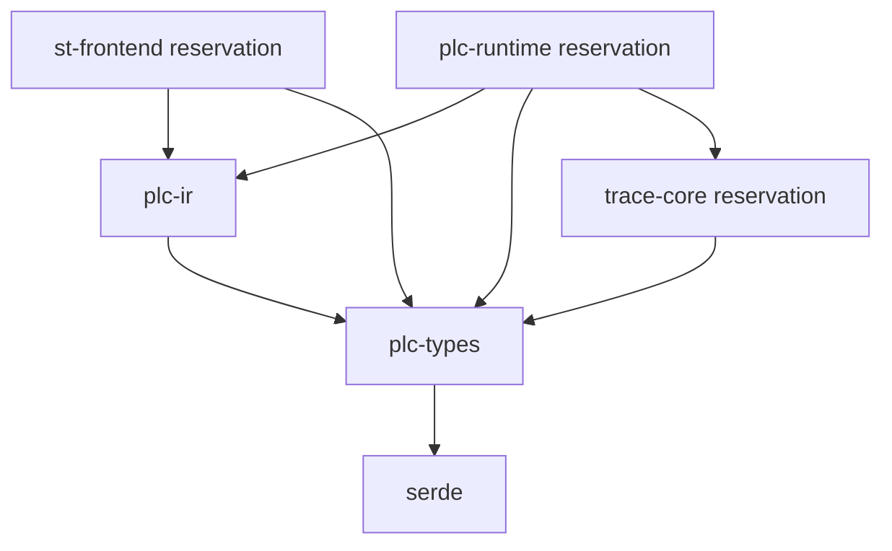

# M1A completion report

Date: 2026-10-14. Scope: M1A semantic foundation only. M0 remains approved; M1A implementation is ready for technical-lead architecture/code review before M1B.

## Completed

| Task    | Result                                                                                                     |
| ------- | ---------------------------------------------------------------------------------------------------------- |
| M1A-001 | Alpha values with checked construction, exact type identity/equality, validated serde round trips.         |
| M1A-002 | Reusable conservative assignment/unary/binary compatibility and documented matrices.                       |
| M1A-003 | Stable symbols, POU ownership, categories, global/local namespaces, checked resolution/redeclarations.     |
| M1A-004 | Private diagnostic records, checked codes/messages, severities, categories, source and related identities. |
| M1A-005 | Checked document/element IDs, all four provenance tags, optional text spans, checked source registry.      |
| M1A-006 | Specified and implemented typed structured semantic IR with reserved FB call bindings.                     |
| M1A-007 | Static validator returning compiler diagnostics or immutable borrowed ValidatedProgram.                    |
| M1A-008 | Small test-only fixture assembler under plc-ir/tests/support.                                              |
| M1A-009 | Four requested direct-construction golden programs plus a provenance-only mapping test.                    |
| M1A-010 | Cargo graph audit and an enforced semantic-crate dependency guard.                                         |
| M1A-011 | Private struct fields, validated construction, immutable access, explicit registry declaration APIs.       |
| M1A-012 | Roadmap/architecture/specifications/development references updated for actual headless work.               |

No user-visible change was introduced; the human checklist is unchanged.

## Files

Added:

```text
crates/plc-types/src/compatibility.rs
crates/plc-types/src/identity.rs
crates/plc-types/src/source.rs
crates/plc-types/src/symbols.rs
crates/plc-types/src/values.rs
crates/plc-ir/src/model.rs
crates/plc-ir/src/validation.rs
crates/plc-ir/tests/support/mod.rs
crates/plc-ir/tests/semantic_golden.rs
crates/plc-ir/tests/validation.rs
docs/adr/0009-semantic-foundation.md
docs/spec/TYPE_SYSTEM.md
docs/spec/SYMBOL_MODEL.md
docs/spec/SOURCE_MAPPING.md
docs/spec/CANONICAL_PLC_IR.md
docs/M1A_REPORT.md
```

Changed:

```text
crates/plc-types/src/lib.rs
crates/plc-types/src/diagnostics.rs
crates/plc-ir/src/lib.rs
tests/architecture/boundaries.test.mjs
docs/adr/README.md
docs/spec/DIAGNOSTICS.md
docs/spec/PLC_FEATURE_MATRIX.md
docs/spec/TEST_STRATEGY.md
docs/architecture/ARCHITECTURE.md
docs/ROADMAP.md
docs/DEVELOPMENT.md
README.md
```

AGENTS.md, Cargo manifests/lockfile, frontend, IPC v2, native command adapter, shell/styles, launchers, human checklist, and reserved execution/simulation/language modules are unchanged. Generated build/smoke artifacts are ignored. Existing Git staging was preserved; no commit or remote was created.

## Architecture

[ADR-0009](adr/0009-semantic-foundation.md) fills the representation decisions intentionally left open in ADR-0002, within the assigned M1A scope. It awaits review before M1B. Shared semantic vocabulary stays in plc-types; typed IR and static validation stay in plc-ir. No new crate or dependency was needed.

The M0 text-only source constructor/public diagnostic fields were replaced with the language-neutral source model/private diagnostic API. No production consumer outside plc-types used that API, no diagnostic IPC schema or persisted project exists, and category/severity wire names remain stable.

## M1A type decisions

| Type | Exact representation / policy                                                                                                                     |
| ---- | ------------------------------------------------------------------------------------------------------------------------------------------------- |
| BOOL | Rust bool, exactly false/true; no numeric truthiness.                                                                                             |
| INT  | Rust i16, -32768 through 32767; checked i64 construction, no wrapping/truncation.                                                                 |
| REAL | Private finite IEEE 754 binary32 f32; NaN/infinities rejected, negative zero normalized, subnormals allowed, exact equality.                      |
| TIME | Private u64 microsecond duration, 0 through u64::MAX; signed ingress checked; no host clock/time-of-day; serde decimal string preserves all bits. |

Only same-type assignment is permitted. No implicit or explicit PLC conversion is implemented. TIME arithmetic and mixed numeric operations/comparisons are unsupported. Host construction checks are not language conversions. See [TYPE_SYSTEM.md](spec/TYPE_SYSTEM.md).

## Symbol identity

SymbolId and PouId are separate nonzero u32 types supplied by a project assembler. Names are independent display/resolution data; IR refers only to IDs. Original names are preserved and Alpha lookup deliberately folds ASCII case. Locals shadow globals; foreign POU locals are inaccessible. IDs stay stable in one compiled representation. Future persisted/recompiled identity allocation is not implemented.

## Source mapping

Every IR expression/statement has a SourceRef consisting of document and element IDs. A checked SourceMap resolves it to language and optional TextSpan. ST/STL can carry one-based Unicode scalar text spans; future LAD/FBD elements can carry graphical identity without text. This provides common provenance for future highlights/monitoring/replay without implementing a language or generating execution evidence.

## Canonical IR

Programs contain immutable declarations/source registry, one Program entry, and ordered bodies. Typed expressions represent constants, reads, unary/binary semantic operations; statements represent assignment, structured IF, and reserved FB calls. The validator checks declared result claims and all child paths, returning diagnostics for invalid candidates.

The IR carries semantic operators and identities, so it contains no ST grammar/tokens, LAD geometry/contacts, FBD editor graph, or STL mnemonics. It has no operand stack, addresses, scheduler, or VM instructions. A later approved execution representation can be lowered from this common semantic form. See [CANONICAL_PLC_IR.md](spec/CANONICAL_PLC_IR.md).

## IR example

Conceptual `Motor := Start AND NOT Stop;`, with BOOL declarations:

```text
Assign Motor#3 @source(assign)
  Binary AND : BOOL @source(and)
    Read Start#1 : BOOL @source(start)
    Unary NOT : BOOL @source(not)
      Read Stop#2 : BOOL @source(stop)
```

Each label denotes a registered SourceRef. No output was calculated or written.

## Dependency graph

Arrows mean imports/dependencies; the runtime and trace crates remain reservations.



plc-ir has only plc-types as a normal dependency; plc-types has only serde. Cargo metadata resolves the acyclic workspace. Core dependency closure excludes desktop/contract/UI/language implementations. The stricter semantic test excludes runtime/simulation/trace/protocol dependencies from semantic crates.

## Tests

Final commands and results:

| Command / canonical stage                                                                 | Result                                                                                                                     |
| ----------------------------------------------------------------------------------------- | -------------------------------------------------------------------------------------------------------------------------- |
| node scripts/rust.mjs test --locked -p plc-types -p plc-ir                                | PASS: 39 focused tests: 22 plc-types, 5 golden/mapping, 12 validator.                                                      |
| node scripts/rust.mjs clippy --locked -p plc-types -p plc-ir --all-targets -- -D warnings | PASS: no warnings.                                                                                                         |
| npm run validate                                                                          | PASS: full check plus native desktop smoke; exit 0.                                                                        |
| npm run format:check (inside validate)                                                    | PASS: Prettier and cargo fmt.                                                                                              |
| npm run typecheck (inside validate)                                                       | PASS.                                                                                                                      |
| npm run lint (inside validate)                                                            | PASS: ESLint and full workspace/all-target clippy.                                                                         |
| npm run test:architecture (inside validate)                                               | PASS: 9 tests, no failures/skips.                                                                                          |
| npm run test:frontend (inside validate)                                                   | PASS: 18 tests, no failures/skips.                                                                                         |
| npm run test:rust (inside validate)                                                       | PASS: 46 substantive tests, no failures/skips.                                                                             |
| npm run build (inside validate)                                                           | PASS: production Vite assets and TypeScript.                                                                               |
| npm run test:desktop (inside validate)                                                    | PASS: real native debug build/start, WebView2, IPC v2 response/rejection, seven panels, disabled controls, no page errors. |

There are 73 substantive automated tests across Rust/frontend/architecture, plus native smoke. Empty reservation/doc-test suites are excluded from that count. Focused tests are included in the workspace total, not counted twice.

Early attempts encountered a transient Windows application-control rejection of a build script and clippy collapsible-if warnings. A normal build retry succeeded; the nested conditionals were corrected. No security setting was changed and no check was disabled. The final canonical validation passed.

Native evidence is regenerated at artifacts/desktop-smoke/result.json, desktop.png, and native.log. It reports applicationStarted=true, real IPC contractVersion=2, execution=unavailable, buildContext=development, APP-IPC-001 for incompatible requests, and pageErrors=[]. This batch did not build a new release or claim a manual visual review.

## Acceptance criteria

| #   | Criterion                         | Result / evidence                                                          |
| --- | --------------------------------- | -------------------------------------------------------------------------- |
| 1   | Explicit tested Alpha types       | PASS: checked values, boundaries, finite REAL/TIME policies, round trips.  |
| 2   | Documented/reusable compatibility | PASS: explicit matrix and shared unary/binary/assignment functions.        |
| 3   | Language-independent symbols      | PASS: IDs, categories, ownership, resolution and error tests.              |
| 4   | Shared diagnostics                | PASS: checked private data, stable codes, source/related identities.       |
| 5   | Cross-language source foundation  | PASS: typed anchors, optional spans, registry tests for all tags.          |
| 6   | Formal canonical IR specification | PASS: abstract schema, typing/structure/validation boundary, alternatives. |
| 7   | Strongly typed Rust IR            | PASS: enums, checked payloads, private representation fields.              |
| 8   | Syntax independence               | PASS: semantic operators/IDs only; provenance does not select semantics.   |
| 9   | Invalid IR yields diagnostics     | PASS: negative/boundary tests and immutable validated wrapper.             |
| 10  | Semantic golden tests             | PASS: all four requested examples validated without execution.             |
| 11  | No execution implementation       | PASS: runtime/simulation/trace crates retain only reservations/version.    |
| 12  | No UI-owned semantics             | PASS: frontend/IPC/shell unchanged, dependency/renderer guards pass.       |
| 13  | M0 regression validation          | PASS: full canonical gate including real native IPC.                       |
| 14  | Clean Cargo graph                 | PASS: metadata and dependency guards; no crate/dependency added.           |

## Assumptions

The smallest generic Alpha profile uses signed 16-bit INT, finite binary32 REAL, microsecond TIME aligned with ADR-0003, and ASCII case-insensitive identifier resolution. Globals are internal/local declarations; I/O/InOut categories belong to a POU. No cross-type conversion is assumed. These choices are documented for review rather than claiming vendor/full IEC conformance.

## Known limitations

Static validation establishes structure and type correctness only. Arithmetic evaluation/faults, scan ordering, storage permissions, and call signatures are not specified as executable behavior. Reserved calls cannot pass validation. No inbound IR schema or project loader exists; validator traversal limits alone do not bound candidate allocation/destruction. IDs are stable within a compiled representation, not yet across saved/recompiled projects. No user-visible semantic feature ships in this batch.

## Scope audit

No VM, instruction evaluator, scheduler, scan cycle, SimulationClock implementation, memory/process image, parser/lexer/AST, Monaco language support, timer/TON/counter behavior, process/device simulation, network/protocol/Modbus, grading, trace recording, timeline, variable forcing, or RUN/STOP behavior entered this batch. LAD/FBD/STL exist only as provenance identifiers and previously reserved directories. Run/Pause/Stop/Single Scan remain disabled.

Git was already initialized and has no remote. AGENTS.md and the inspected frontend/IPC hashes remain unchanged. The accepted shell was not redesigned.

## Next dependency

Technical-lead review of ADR-0009, the type/symbol/source/diagnostic APIs, the canonical IR specification, and validator/golden tests. Only explicit approval can authorize a separately scoped M1B batch. No M1B work has begun.

## Gate

M1A GATE: PASS
