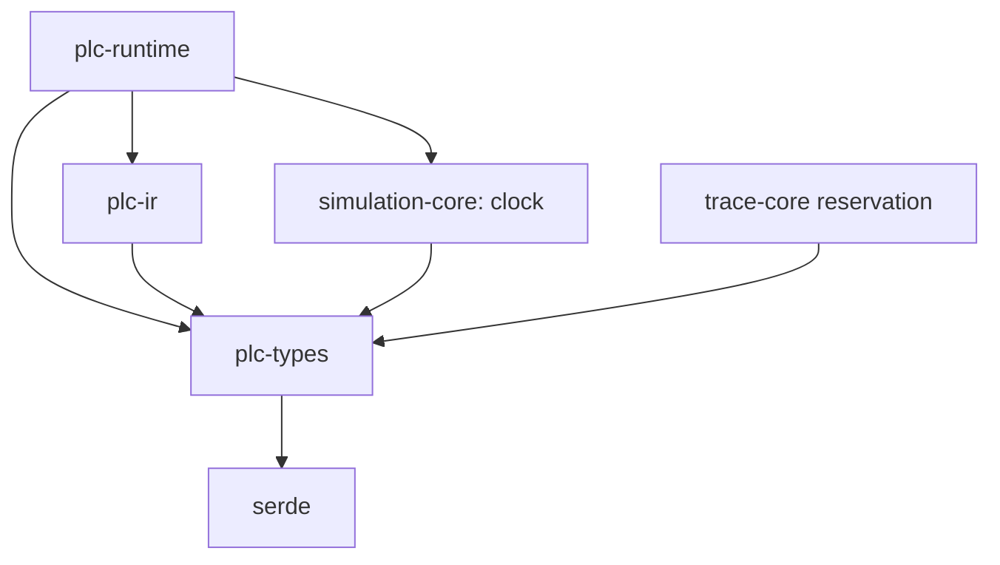

# M1B completion report

Date: 2026-10-14. M0/M1A are approved. M1B implements only the assigned deterministic headless runtime foundation and stops for technical-lead code review before M1C.

## Completed

| Task        | Result                                                                                                                        |
| ----------- | ----------------------------------------------------------------------------------------------------------------------------- |
| M1B-001     | Exact runtime semantics and ADR-0010, including the explicitly authorized dependency reversal and trace-recording deferral.   |
| M1B-002     | SymbolId-keyed compiled entry roles; staged/input/committed/working/output memory boundaries.                                 |
| M1B-003     | Authoritative PlcType defaults, including canonical REAL positive zero.                                                       |
| M1B-004     | Compiler rejection of read-only entry input assignment; permitted output/local/global writes.                                 |
| M1B-005/006 | Separate owned, bounded ExecutionPlan lowered only from ValidatedProgram; no borrowed canonical Program.                      |
| M1B-007     | Checked INT, finite canonical REAL, exact comparisons, left-to-right/eager expressions, exclusive IF execution.               |
| M1B-008     | Stable source-aware runtime faults separated from internal invariant errors.                                                  |
| M1B-009     | Positive configurable per-scan operation budget with exact charging and transactional exhaustion.                             |
| M1B-010     | Checked deterministic SimulationClock in simulation-core.                                                                     |
| M1B-011/012 | One synchronous cyclic task; transactional completion, exact time/count, Ready/Faulted and explicit reinitializing reset.     |
| M1B-013/014 | Substantive deterministic execution/fault/boundary tests and all four direct-IR executable golden programs.                   |
| M1B-015     | Acyclic runtime -> simulation-core -> types direction enforced by Cargo architecture tests; no trace execution dependency.    |
| M1B-016     | Runtime specification, architecture, roadmap, feature matrix, diagnostics, test strategy, and development references updated. |

No UI functionality or human runtime interaction checklist was added.

## Files

Added:

```text
crates/plc-runtime/src/errors.rs
crates/plc-runtime/src/executor.rs
crates/plc-runtime/src/memory.rs
crates/plc-runtime/src/operators.rs
crates/plc-runtime/src/plan.rs
crates/plc-runtime/src/runtime.rs
crates/plc-runtime/tests/semantic_runtime.rs
crates/simulation-core/src/clock.rs
docs/adr/0010-transactional-alpha-runtime.md
docs/spec/PLC_RUNTIME_SEMANTICS.md
docs/M1B_REPORT.md
```

Changed:

```text
Cargo.lock
crates/plc-runtime/Cargo.toml
crates/plc-runtime/src/lib.rs
crates/simulation-core/Cargo.toml
crates/simulation-core/src/lib.rs
crates/plc-types/src/values.rs
crates/plc-types/src/diagnostics.rs
crates/plc-ir/src/validation.rs
crates/plc-ir/tests/validation.rs
tests/architecture/boundaries.test.mjs
docs/adr/0009-semantic-foundation.md
docs/adr/README.md
docs/spec/TYPE_SYSTEM.md
docs/spec/SYMBOL_MODEL.md
docs/spec/CANONICAL_PLC_IR.md
docs/spec/DIAGNOSTICS.md
docs/spec/PLC_FEATURE_MATRIX.md
docs/spec/TEST_STRATEGY.md
docs/architecture/ARCHITECTURE.md
docs/ROADMAP.md
docs/DEVELOPMENT.md
README.md
```

The canonical IR data representation, provisional call structure, original value representations, and typed identities were not redesigned. AGENTS.md, frontend/IPC/shell/styles, native handlers, launchers, and HUMAN_TEST_CHECKLIST.md remain unchanged. Git was already initialized; staging was preserved, no commit/remote was created, and generated test/build outputs remain ignored.

## Architecture

[ADR-0010](adr/0010-transactional-alpha-runtime.md) records decisions explicitly assigned by M1B: an owned executable subset, entry-only memory roles, transactional publication, deterministic checked arithmetic, and runtime use of the simulation-core clock. It supersedes the foundation's unused simulation-core -> runtime dependency. Trace recording is deferred under the explicit task constraint, with source metadata and snapshots retained; trace infrastructure is not claimed complete.

The semantic validator stays execution-independent and adds only the assigned entry-input write rule. No categories were made universal physical memory classes. No third-party dependency or crate was added.

## Runtime semantics

single_scan exclusively borrows Runtime. It snapshots staged inputs into an owned read-only image, copies committed writable values into temporary working state, and executes once under a fresh budget. Reads after writes use that same working state, including output reads.

Success prepares next clock/count and the output image, then publishes writable state/outputs atomically, increments completed count, advances time once, and returns an immutable snapshot. Execution or completion faults discard all working writes, preserve prior outputs/internal values/count/time, and enter Faulted. Inputs remain read-only. The last attempted input image is observational state and can reflect the failed attempt; it is not committed writable memory. Outputs are never automatically forced false on fault.

Faulted refuses further scans until reset. Reset preserves plan/configuration, clears the fault, restores every image/staging to type defaults, and sets count/time to zero. Changing a staged input never silently clears a fault.

## Memory model

Explicit MemoryRole compilation maps only the selected Program's Input/Output declarations to ExternalInput/ExternalOutput. Entry Local and Global Local declarations are Internal. Non-entry POU symbols are excluded; entry InOut is rejected as unsupported. Functions/FBs retain only their non-executable ownership metadata.

The private runtime memory has separate staging, last input image, committed writable state, temporary working state, and external committed outputs. SymbolId is the key throughout; no names, addresses, byte images, DBs, forcing, or physical devices are introduced. Input API errors check ID/role/type before mutation. All defaults come from PlcType::default_value.

## Execution representation

```text
Canonical IR -> ValidatedProgram -> checked lowering -> owned ExecutionPlan -> Runtime
```

The public plan has private fields and no public instruction constructor. It owns a distinct typed execution tree, compiled memory roles, and only the source anchors needed by executable nodes. It does not own/borrow canonical Program or ValidatedProgram; the source candidate can be dropped before execution. M1A size/depth limits also bound the owned tree/layout/retained anchors. Missing validated metadata returns an internal lowering error; calls and unsupported declarations return compiler errors. There is no constant folding, bytecode, or call execution.

## Arithmetic semantics

- INT uses checked i16 add/subtract/multiply/negate/divide. Overflow faults with PLC-RUNTIME-002; zero divisor with 003; minimum divided by -1 with 002. Other division truncates toward zero. No wrapping/saturation.
- REAL uses explicit binary32 operations with no fast-math/reassociation/fused operation added. Every arithmetic result passes PlcReal finite/canonical construction. Non-finite results, including zero division, fault with 004 before memory writes. Finite subnormals remain allowed; underflow/negative-zero results become canonical zero as appropriate.
- BOOL logic/equality and same-type numeric/TIME comparisons follow accepted Alpha typing. TIME has no arithmetic.
- Operands evaluate left-to-right; AND/OR eagerly evaluate both operands. Only the selected IF branch runs. Fixed bit-pattern tests and non-associative examples pass in debug and optimized release.

## Clock / scheduler

SimulationClock starts at zero and supports checked explicit advancement in microseconds. Overflow preserves its value. There is no Instant/SystemTime, pacing, sleep/thread, priority, or multiple-task behavior.

RuntimeConfig requires explicit positive cycle period and budget; no hidden defaults. Completed count begins at zero; successful result 1 is at one period. Each successful explicit call executes one cycle and advances exactly one period. Failed attempts leave count/time unchanged, including clock/counter overflow discovered after working execution. The orchestrator is Runtime::single_scan; there is no general scheduler framework.

## Runtime fault codes

| Code            | Meaning                                                                |
| --------------- | ---------------------------------------------------------------------- |
| PLC-RUNTIME-001 | Per-scan operation budget exhausted                                    |
| PLC-RUNTIME-002 | Checked INT overflow, including negate minimum / minimum divided by -1 |
| PLC-RUNTIME-003 | INT division by zero                                                   |
| PLC-RUNTIME-004 | Non-finite REAL arithmetic result                                      |
| PLC-RUNTIME-005 | Virtual clock overflow at completion                                   |
| PLC-RUNTIME-006 | Completed-scan count overflow                                          |

Operation faults use RuntimeFault/Error diagnostics, resolved source metadata, and related assignment symbol where meaningful. Completion overflow has no invented location. APP-CORE-001 remains InternalApplicationError for impossible invariants. PLC-COMP-014 rejects entry input writes; 015 rejects executable entry InOut. Internal errors are never relabeled as student runtime faults.

## Tests

| Command/stage                                                                                                               | Final result                                                                                                              |
| --------------------------------------------------------------------------------------------------------------------------- | ------------------------------------------------------------------------------------------------------------------------- |
| node scripts/rust.mjs test --locked -p plc-types -p plc-ir -p plc-runtime -p simulation-core                                | PASS: 78 focused tests (23 types, 19 IR, 33 runtime, 3 clock).                                                            |
| node scripts/rust.mjs clippy --locked -p plc-types -p plc-ir -p plc-runtime -p simulation-core --all-targets -- -D warnings | PASS; final workspace clippy also passes.                                                                                 |
| node scripts/rust.mjs test --release --locked -p plc-runtime -p simulation-core                                             | PASS: 36 optimized-profile runtime/clock tests.                                                                           |
| npm run validate                                                                                                            | PASS, exit 0: full repository gate and actual native IPC.                                                                 |
| format:check / typecheck / lint within validate                                                                             | PASS: Prettier, cargo fmt, TS, ESLint, all-target workspace clippy with warnings denied.                                  |
| test:architecture within validate                                                                                           | PASS: 10 tests, no failures/skips.                                                                                        |
| test:frontend within validate                                                                                               | PASS: 18 tests, no failures/skips.                                                                                        |
| test:rust within validate                                                                                                   | PASS: 85 substantive workspace tests, no failures/skips.                                                                  |
| build within validate                                                                                                       | PASS: production frontend assets.                                                                                         |
| test:desktop within validate                                                                                                | PASS: native debug build/start, actual Rust IPC v2, rejection, seven panels, disabled execution controls, no page errors. |

There are 113 substantive tests in the canonical gate plus native smoke. Focused/release reruns are not added to that count. Empty reservation and doc-test suites are excluded. An initial integration-test compile found a shadowed helper and unused imports; those were corrected before final focused/full/release checks. No check was disabled.

Native evidence is at artifacts/desktop-smoke/result.json, desktop.png, and native.log. No new desktop release artifact or manual visual review is claimed. A final formatting check after this report is saved is also required.

## Determinism evidence

All requested evidence passes without wall-clock sleeps:

| Required behavior                                                         | Evidence                                                                                                         |
| ------------------------------------------------------------------------- | ---------------------------------------------------------------------------------------------------------------- |
| 1. Identical program/defaults/inputs/period -> identical snapshots/faults | Repeated two-runtime sequence compares results/fault diagnostics exactly.                                        |
| 2. Stable scan inputs                                                     | Staged/image separation and repeated reads; mutation requires exclusive borrow outside scans.                    |
| 3. Read-after-write                                                       | InternalA -> OutputA -> OutputB observe new values in the same scan.                                             |
| 4. Successful internal/output commit                                      | Snapshot equals published state; globals/locals persist across multiple cycles.                                  |
| 5–6. All-write rollback / preserve prior outputs                          | Two successful working writes precede arithmetic/budget failure; all non-default committed values remain intact. |
| 7–8. Failed time/count unchanged                                          | Arithmetic, budget, clock, and count failures preserve both.                                                     |
| 9. Input assignment rejected                                              | IR permission test yields mapped PLC-COMP-014 before lowering.                                                   |
| 10–12. INT overflow / zero / minimum divided by -1                        | Add/subtract/multiply/negate/divide boundary cases produce exact codes.                                          |
| 13. REAL non-finite results                                               | Add/subtract/multiply overflow and zero divisions fault; authoritative REAL remains canonical default.           |
| 14. REAL canonical zero                                                   | Unary negate zero, zero times negative, and underflow test positive-zero bits.                                   |
| 15. TIME comparisons                                                      | All six comparison operators at zero/u64 maximum.                                                                |
| 16. IF selection                                                          | Unselected well-typed division-by-zero branch does not execute; selecting it faults.                             |
| 17. Partial budget exhaustion                                             | Earlier working output/internal writes roll back; exact N/N+1 boundary verified.                                 |
| 18–19. Exact clock / controlled overflow                                  | Explicit advances, ten exact cyclic periods, and failed completion at maximum.                                   |
| 20. Invalid configuration                                                 | Zero period/budget rejected; explicit maximum positive values accepted.                                          |

Additional evidence covers fixed binary32 bits/subnormals, non-associative nesting, eager BOOL behavior, left-first fault identity/source, deterministic full reset, input API atomic errors, unsupported declarations, foreign POU role exclusion, source retention bounds, future-call lowering rejection, and internal error classification. These pass under optimized release as well as debug.

## Dependency graph

Arrows indicate normal dependencies:



simulation-core has no runtime/trace dependency. Runtime has no trace/UI/editor/frontend/protocol dependency. Path edges and lockfile were updated without third-party additions. Full Cargo closure and stricter semantic/runtime guards pass.

## Acceptance criteria

| #   | Criterion                                | Result / reason                                               |
| --- | ---------------------------------------- | ------------------------------------------------------------- |
| 1   | Explicit semantics                       | PASS: runtime spec and ADR-0010.                              |
| 2   | Separate canonical/owned execution forms | PASS: distinct private runtime tree, unchanged IR data model. |
| 3   | Checked plan construction                | PASS: public lowering accepts ValidatedProgram only.          |
| 4   | SymbolId memory                          | PASS: typed ID-keyed maps throughout.                         |
| 5   | Entry-only I/O mapping                   | PASS: explicit roles; non-entry POU declarations excluded.    |
| 6   | Read-only Program Inputs                 | PASS: compiler permission error and writable-map defense.     |
| 7   | Intra-scan write visibility              | PASS: internal and output read-after-write tests.             |
| 8   | Atomic success commit                    | PASS: prepared publication under exclusive borrow.            |
| 9   | Atomic runtime rollback                  | PASS: partial arithmetic/budget writes discarded.             |
| 10  | No failed time advance                   | PASS: all fault paths verified.                               |
| 11  | No failed completed increment            | PASS: all fault paths verified.                               |
| 12  | Checked INT execution                    | PASS: normal/boundary/error tests in both profiles.           |
| 13  | Finite REAL invariant                    | PASS: every arithmetic result validated before memory use.    |
| 14  | TIME without OS clock                    | PASS: pure u64 microsecond data and comparisons.              |
| 15  | Deterministic SimulationClock            | PASS: exact/overflow/repeat tests.                            |
| 16  | One cyclic task                          | PASS: one explicit synchronous single_scan orchestrator.      |
| 17  | Independent budget                       | PASS: positive config and exact per-operation charging.       |
| 18  | Stable mapped faults                     | PASS: codes/category/severity/source/related identity tests.  |
| 19  | Executable direct-IR goldens             | PASS: all four required programs.                             |
| 20  | No TON/FB execution                      | PASS: no executable call case; validation/lowering reject.    |
| 21  | No frontend execution                    | PASS: unchanged frontend/IPC and native disabled controls.    |
| 22  | Full M0/M1A regressions                  | PASS: canonical full gate and optimized runtime checks.       |

## Assumptions

Default initial values are the approved type defaults; no custom internal-state seed/forcing API was invented. Period/budget are explicit positive caller configuration. Reset reinitializes all images including staging, outputs, count, and time. Non-entry declarations remain metadata only. Global Local is the supported global shape. These are documented Alpha choices consistent with the assignment, not universal POU or vendor rules.

## Known limitations

Execution is headless direct IR only. REAL bit-level evidence currently covers this Windows target in debug/release; additional supported targets must run the same tests before cross-platform determinism is claimed. Candidate construction/import allocation remains outside the runtime lowering boundary; there is no inbound project/IR deserializer. The provisional FB call shape/signatures have not been finalized. Runtime snapshots are not trace recording or a complete educational experience.

## Scope audit

No TON/TOF/TP, counters or edge blocks, Function/FB execution, ST lexer/parser/AST/Monaco support, LAD/FBD/STL implementation, process/devices, network/protocol/Modbus/OPC UA, trace recorder/timeline, grading, forcing, hardware/Siemens addressing, multi-task/interrupt/thread/pacing/background loop, or UI Run/Pause/Stop/Single Scan behavior was added. Existing execution buttons remain unavailable; the native test confirms it.

## Next dependency

Technical-lead review of ADR-0010, runtime semantics, lowering/memory/executor/clock APIs, and deterministic fault/transaction tests. M1C requires explicit review approval and a new scoped task. No M1C work has begun.

## Gate

M1B GATE: PASS
