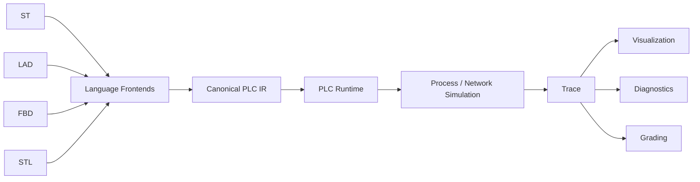
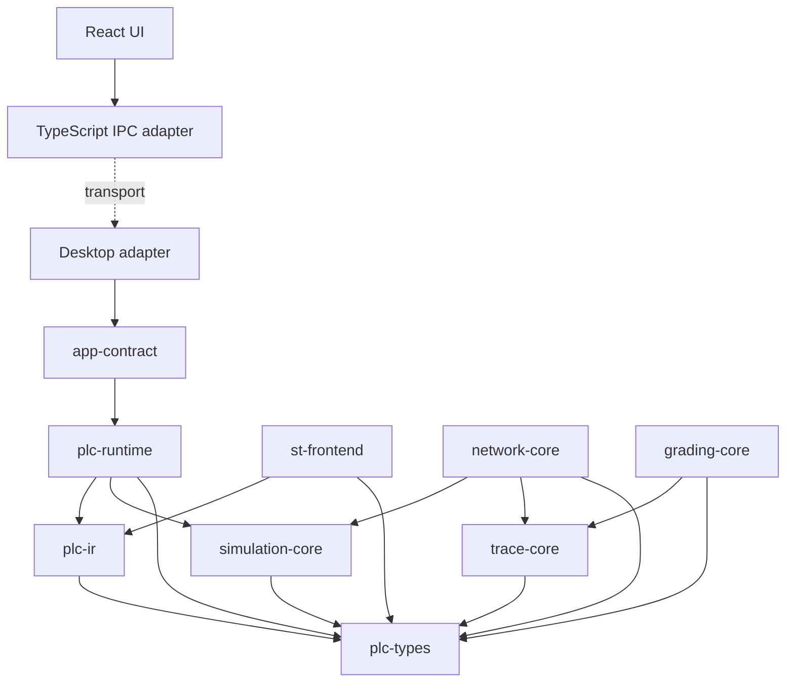

# PLC Lab architecture

## M3A manual process boundary

The process-simulation crate depends only on plc-types, never runtime/host/UI. desktop-session imports it beside the accepted runtime/compiler/contract. simulation-core remains the unchanged clock leaf; plc-runtime never imports a physical model. This authorized placement is recorded in [ADR-0014](../adr/0014-process-simulation-boundary.md), superseding ADR-0005's reserved placement while preserving model/renderer separation.

Sensors(t) staged -> Runtime::single_scan -> committed Outputs(t) and core time/count -> fixed integer Tank step for cyclePeriod -> Process(t+dt) -> derived Sensors(t+dt) staged -> combined snapshot -> React/SVG. The same application mutex covers the full cycle/observation. Failed scans do not step the plant. Process state is private physical state, not hidden PLC symbols. Binding metadata resolves exact role/type/name to actual runtime identities. PROCESS sensors reject manual writes in Rust.

Explicit attach/detach/reset process commands target RuntimeSessionId. Successful Load/Unload discards the scene; failed/stale Load retains it and accepted LoadIntent ordering. Runtime reset preserves plant/restages sensors; Process reset reinitializes plant/sensors and preserves all PLC memory/fault/count/time. IPC DTOs carry optional plant state and input authority; they own no model. React only renders supplied values/booleans and normalized geometry. Example ST is source data under scenes/tank-filling, inserted only by confirmation. No continuous execution, trace, network, grading or additional language is implemented.

## M2B application session boundary

Editor Source -> Compile (pure metadata) is separate from Source -> explicit Load -> ST compiler -> existing validation -> owned ExecutionPlan -> desktop-session -> Runtime::single_scan -> coherent RuntimeSnapshotDto -> UI. Desktop owns one Arc<RuntimeSessionService>; a synchronous mutex serializes replacement/mutations/observation on blocking workers. The new headless application crate imports app-contract/st-frontend/plc-runtime/plc-types. Core and ST crates never import the service or Tauri.

Snapshots carry staged Inputs, committed Outputs/Locals, public TON Q/ET and exact Rust count/time/configuration. No IR, plan, private epoch or mutable storage map is transported. Source revisions and session generations have distinct responsibilities. Single Scan is deterministic and not real-time paced; React caches/formats returned snapshots. No process/network/trace/grading implementation is introduced. [ADR-0013](../adr/0013-desktop-runtime-session.md) and the [session specification](../spec/DESKTOP_RUNTIME_SESSION.md) define this increment.

## M2A source and compilation boundary

ST Source -> Lexer -> dedicated ST AST -> Semantic Compiler -> Canonical PLC IR -> existing Validator -> ValidatedProgram -> existing ExecutionPlan -> existing PLC Runtime. The final two steps are exercised headlessly; desktop Compile stops after validation and declaration metadata. No runtime semantics changed.

Monaco -> packages/ipc compileSt (IPC v3) -> thin Tauri command/blocking worker -> app-contract -> st-frontend -> diagnostics/symbol summary -> Monaco markers, Variables declarations and Diagnostics. The frontend explicitly converts scalar spans to UTF-16 and rejects stale source/request revisions. It never receives IR/plans or evaluates PLC logic. Execution controls and process/network/timeline/grading remain unavailable.

st-frontend production depends only on plc-types/plc-ir; runtime/clock are dev-dependencies for real-source execution tests. app-contract adds st-frontend/plc-types for compile DTO adaptation. Core crates keep their existing dependencies and cannot import React/Tauri/frontends. [ADR-0012](../adr/0012-alpha-st-compiler.md) and [Alpha ST spec](../spec/STRUCTURED_TEXT_ALPHA.md) document this approved scope. Earlier milestone tables below describe their original state.

## Canonical execution chain

Runtime faults and compiler diagnostics originate in their producing modules with preserved source mappings. The full chain defines eventual educational behavior. M1A/M1B are accepted; M1C adds headless standard TON code and tests to directly constructed validated IR. No language frontend, process/network model, trace recorder, or execution UI exists. No stage is bypassed by a JavaScript evaluator or a language-specific runtime.

## Workspace map

| Location                 | Responsibility                                                                   | Current status                                                                    |
| ------------------------ | -------------------------------------------------------------------------------- | --------------------------------------------------------------------------------- |
| apps/desktop/src         | React application entry                                                          | Working                                                                           |
| apps/desktop/src-tauri   | Tauri host and thin Rust command adapters                                        | Working, core information only                                                    |
| crates/app-contract      | Rust IPC DTOs, information service, TypeScript generator                         | Working                                                                           |
| packages/ipc             | Typed IPC wrapper and runtime validation                                         | Working                                                                           |
| packages/ui              | Shell and future presentation components                                         | Seven reserved panels, all execution disabled                                     |
| crates/plc-types         | Values, type compatibility, IDs, symbols, sources, diagnostics, FB declarations  | M1A values plus M1C typed signatures/catalog; no runtime state                    |
| crates/plc-ir            | Typed canonical semantic IR and validation                                       | M1A expressions/assignments/IF plus M1C declared calls and bindings; no execution |
| crates/plc-runtime       | Owned plans, entry memory, one cyclic task, transactional execution and FB state | Accepted M1B executor plus M1C headless TON code; validation evidence in report   |
| crates/simulation-core   | Shared deterministic clock; future process models                                | M1B checked clock only; no runtime dependency                                     |
| crates/trace-core        | Canonical trace vocabulary and recording                                         | Reserved crate                                                                    |
| crates/network-core      | Virtual kernel and protocol adapters                                             | Reserved crate                                                                    |
| crates/grading-core      | Behavioral trace grading                                                         | Reserved crate                                                                    |
| languages/st             | ST source → validation/analysis → IR                                             | Reserved crate, no parser                                                         |
| languages/lad, fbd, stl  | Later frontends/document models                                                  | Directory reservations                                                            |
| exercises, scenes        | Versioned data-driven content                                                    | Directory reservations                                                            |
| tests/conformance        | Headless integration and semantic harness                                        | Foundation integration tests only                                                 |
| crates/plc-ir/tests      | Test-only IR assembly, golden programs, negative/boundary validation             | Headless M1A semantic integration tests                                           |
| crates/plc-runtime/tests | Direct-IR execution and determinism tests                                        | M1B golden/transaction/arithmetic/clock/budget/role tests                         |
| tests/architecture       | Enforced dependency/host boundaries                                              | Working                                                                           |
| tests/e2e                | Real native shell and IPC acceptance                                             | Windows WebView2 harness                                                          |

VERSION constants describe Cargo package versions; they implement no simulation behavior. Empty crates intentionally have no artificial unit tests. Their existence and dependency closure are checked at repository level; substantive diagnostics and contract modules have unit/boundary/error tests.

## Allowed dependency direction

Core libraries never depend on desktop, app-contract, language frontends, React, or Tauri. The graph is acyclic. [ADR-0010](../adr/0010-transactional-alpha-runtime.md), explicitly authorized by M1B, replaces the foundation's reserved simulation-core -> runtime edge: plc-runtime now uses simulation-core's clock; simulation-core imports only plc-types. Neither execution crate depends on trace-core. Future application orchestration can wire independent runtime/process/network services without a reverse dependency; it is not implemented now.

Only packages/ipc imports the Tauri frontend API; ESLint enforces this restriction. The architecture test traverses internal core dependencies to catch reverse coupling and verifies that semantic crates cannot depend on runtime/simulation/trace/protocol modules. A compiled headless conformance target proves core crates are linkable without a desktop host.

## Implemented semantic boundary (M1A)

`plc-types` owns the four Alpha values, conservative assignment/operator typing, typed nonzero identities, case-insensitive declaration resolution, shared diagnostics, and a language-neutral source registry. `plc-ir` depends only on `plc-types`; it owns semantic expression/statement enums and static validation. No new crate or dependency was added.

Program candidates own immutable symbol/source tables, a function-block catalog and ordered bodies. Validation returns diagnostics or an immutable borrowed `ValidatedProgram`; it checks symbol visibility, result types, assignments, operands, BOOL conditions, entry ownership, source references, bounded traversal and FB catalog/binding relationships. Structured IF requires no branch-target machinery. M1C replaces the provisional call with one instance ID and typed bindings; each instance resolves exactly one definition and only semantic Standard(Ton) is executable.

See [type rules](../spec/TYPE_SYSTEM.md), [symbols](../spec/SYMBOL_MODEL.md), [source mapping](../spec/SOURCE_MAPPING.md), and the [canonical IR specification](../spec/CANONICAL_PLC_IR.md). These APIs are headless and independent of language syntax, React, Tauri, editors, rendering, protocols, and storage addresses. They do not evaluate expressions, allocate PLC variable memory, advance a clock, or record traces. Test builders live only under `plc-ir/tests/support`.

The desktop shell, styles, core-information IPC v2, human launchers, and manual checklist remain unchanged. M1C is headless; execution controls remain unavailable. ADR-0009 is accepted; its provisional FB call is superseded by authorized ADR-0011.

## Implemented execution boundary (M1B)

`plc-runtime::lower` consumes checked semantic information to create an owned ExecutionPlan, with private execution trees and explicit entry memory roles. The plan owns source metadata and contains no borrowed IR, editor objects, or public instruction-construction API. Runtime takes it by value; the original candidate can be dropped.

An Alpha entry-only layout maps entry Input/Output roles to external boundaries, entry Locals/globals to internal writable state, skips non-entry POU declarations, and rejects executable InOut. This is not a universal physical-I/O interpretation of VariableCategory. Semantic validation rejects entry Input writes, including FB associations. User function/FB bodies remain unimplemented.

Runtime owns one synchronous cyclic task. Each call snapshots staged inputs and copies committed state into working memory. Checked expressions and selected IF bodies run with an independent operation budget. Success atomically publishes working values and outputs, increments completed count, and advances the clock once. Any execution/completion fault discards writes, preserves outputs/count/time, records a mapped diagnostic, and enters Faulted until explicit reinitializing reset.

simulation-core supplies checked u64 microsecond time only. Runtime retains SourceRef/SourceMap and immutable snapshots/faults for future consumers, but records no trace events. See [PLC_RUNTIME_SEMANTICS.md](../spec/PLC_RUNTIME_SEMANTICS.md) for arithmetic, budget charging, numbering, and reset. M1B is accepted; M1C requires technical-lead review before M2.

## Standard function-block extension (M1C)

Definition (FunctionBlockId, explicit kind and ordered signature) -> declared instance (FunctionBlockInstanceId, sole definition reference, owner/name) -> call (instance ID and typed bindings) -> private runtime state (instance-ID map). ParameterId is scoped to the definition. Standard factories own exact signatures; names/numeric definition IDs never select behavior. User-defined signatures are metadata only.

Validated TON lowers into an owned instruction with normalized IN/PT expressions, optional Q/ET SymbolId targets and SourceRef. The executor performs no name/signature lookup. It uses fixed scan-start SimulationClock time and updates private working activation/Q/ET state. Instance working maps are cloned alongside PLC working memory and published together only after execution and clock/count completion succeeds. Every fault discards both, preserving the accepted last-attempted input image. Reset clears all epochs and outputs.

RuntimeSnapshot::function_blocks exposes an owned immutable instance-ID map of typed TON Q/ET only. Private activation timestamps do not pollute symbol memory or frontend contracts. See [ADR-0011](../adr/0011-function-block-instance-model.md), [STANDARD_FUNCTION_BLOCKS.md](../spec/STANDARD_FUNCTION_BLOCKS.md), [TON_SEMANTICS.md](../spec/TON_SEMANTICS.md), and [M1C validation evidence](../M1C_REPORT.md). No dependencies or new crates are required; TON belongs in plc-runtime, never simulation-core or React.

## Planned scan model

The eventual educational scan adds process/network updates and ordered trace evidence around execution. M1B's assigned subset is input snapshot -> working execution -> transactional commit -> exact cycle advancement -> result. No simulated physical consequence or trace is fabricated. Future multi-service ordering and fault policies require their own approved extension; the UI frame rate never advances authoritative state.

## Visualization and education

Program monitoring, Process, Network, and Timeline consume Rust state and source-aware trace evidence. Grading consumes the same trace to evaluate behavior and timing. Exercise definitions live outside UI views. A functioning editor alone does not constitute a meaningful PLC exercise; DEMO-001 must prove the complete ST → tank behavior → visualization → trace → grading chain before production graphical language editors.

## Decision references and scope

See [ADRs](../adr/README.md), [feature matrix](../spec/PLC_FEATURE_MATRIX.md), [diagnostics](../spec/DIAGNOSTICS.md), [IPC](FRONTEND_BACKEND_BOUNDARY.md), and [roadmap](../ROADMAP.md). Persistence remains a design only. No editor/language frontend, other standard block, user FB/function execution, process/network simulation, protocol, database, authentication, grading, or trace recording exists. M0/M1A/M1B are approved; M1C stops for code review before M2.
